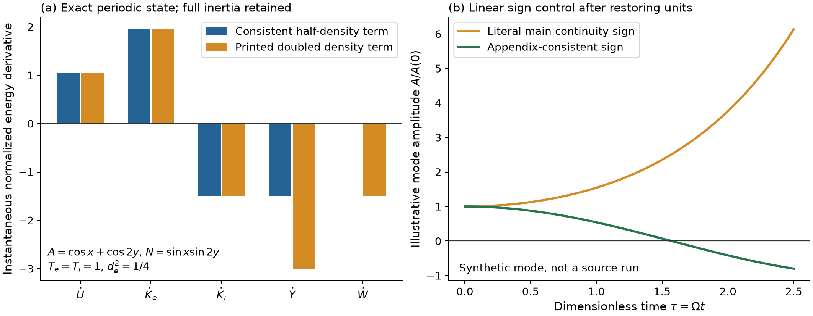
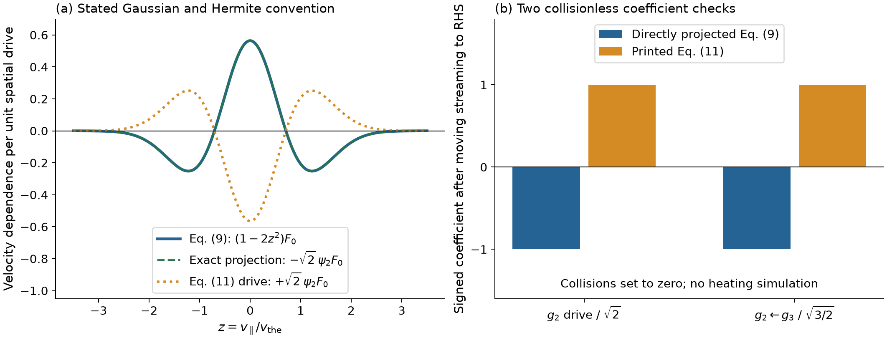

# Equation consistency in electron-only reconnection

Taylor Kalin

This computational audit checks displayed equations in Liu et al., *Electron-only magnetic reconnection and inverse magnetic-energy transfer at sub-ion scales*, arXiv:2407.06020v2, and its inspected publisher accepted manuscript. It contains original exact synthetic controls and independent review records. The accepted manuscript is an authentic CHORUS copy, **not the uninspected journal version of record**. Supplementary findings concern the supplement embedded in arXiv v2.

The controls isolate the main-to-Appendix continuity sign, a missing dimensional pressure coefficient, the density coefficient in the stated quadratic invariant, and collisionless Gaussian/Hermite projection signs. They retain positive checks of the source's reconnection-rate and conditional decay scalings. Recognizable transcription errors are a plausible explanation. These results do not determine the equations actually advanced by GX or invalidate the source's numerical curves.

- [Computational methods and scope](COMPUTATIONAL_METHODS.md)
- [Reproduction instructions](REPRODUCIBILITY.md)
- [Exact results](data/equation-controls.json)
- [Periodic energy ledger](data/periodic-energy-controls.csv)
- [Linear sign controls](data/linear-symbol-controls.csv)
- [Retained rate controls](data/retained-rate-controls.csv)
- [Retained conditional exponents](data/conditional-exponents.csv)

The figures are explanatory synthetic calculations, not source simulation outputs. The computational package is published at [Teylersf/electron-only-equation-audit](https://github.com/Teylersf/electron-only-equation-audit). A manuscript is in preparation; this code snapshot makes no claim of journal acceptance or a published manuscript.

Code is licensed under [MIT](LICENSE-CODE). Original explanatory text and figures are licensed under [CC BY 4.0](LICENSE-MANUSCRIPT). Source scientific ideas remain attributed to their original authors; source PDFs and credentials are excluded.
